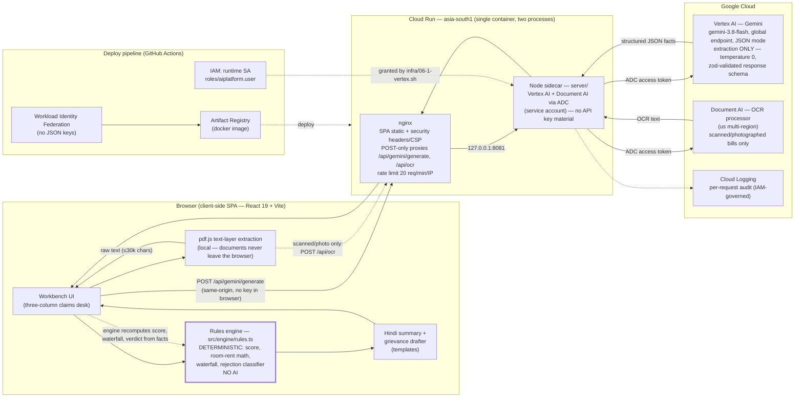

# ClaimSahayak — Architecture

One diagram, two trust boundaries. Everything left of the engine boundary is
deterministic TypeScript; the only AI in the system reads documents, it never
computes a rupee.

## Trust boundaries

1. **Engine boundary (in the browser).** `src/engine/` has no React imports and no
   network calls. Gemini's output is validated with zod and reduced to typed facts
   (`Policy`, `HospitalEpisode`, `BillLine`); every score, deduction and payout is
   recomputed from those facts by deterministic code covered by vitest.
2. **Key boundary (removed).** Phase 06 step 6.1 eliminated the managed API key: the
   sidecar authenticates to Vertex AI with the Cloud Run service account (Application
   Default Credentials), so there is no key material in the container, the image, or the
   client — access is IAM-governed and audited in Cloud Logging. A user-supplied key
   (Settings → API key) remains as the deliberate demo override and stays in that
   browser's localStorage.

## Request flow (upload path)

1. Browser extracts PDF text locally with pdf.js. If the text layer is empty (scan) or
   the file is a photo, the browser POSTs it to same-origin `/api/ocr`; the sidecar runs
   Cloud Document AI OCR and returns text, which then follows the same extraction path.
2. Browser POSTs the extraction prompt to the same-origin `/api/gemini/generate`.
3. nginx rate-limits, caps body size, and forwards to the sidecar (127.0.0.1:8081),
   which calls Vertex AI with an ADC token.
4. Gemini returns schema-constrained JSON; the browser validates it with zod (one
   retry with validation errors appended), then maps it to a `CaseFile`.
5. The rules engine computes score, flags, waterfall, rejection class, grievance
   letter and Hindi summary — all in `useMemo`, all reproducible.

## State

Stateless. No accounts, no database, no server-side sessions; nothing persists beyond
the user's own localStorage (API-key override, UI prefs). Persistence, if ever added,
is Phase 06 step 6.4 and must be consent-gated.
