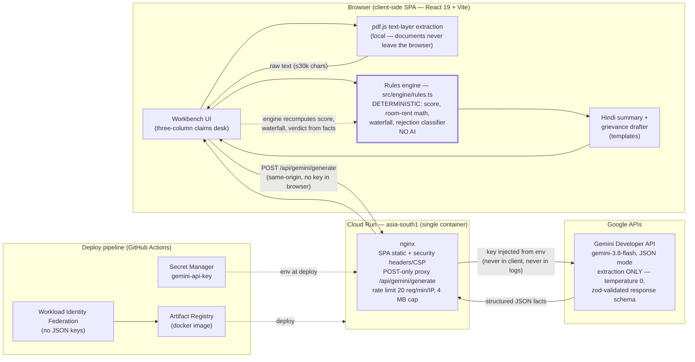

# ClaimSahayak — Architecture

One diagram, two trust boundaries. Everything left of the engine boundary is
deterministic TypeScript; the only AI in the system reads documents, it never
computes a rupee.

## Trust boundaries

1. **Engine boundary (in the browser).** `src/engine/` has no React imports and no
   network calls. Gemini's output is validated with zod and reduced to typed facts
   (`Policy`, `HospitalEpisode`, `BillLine`); every score, deduction and payout is
   recomputed from those facts by deterministic code covered by vitest.
2. **Key boundary (in the container).** The managed Gemini key exists only as a
   Secret Manager secret injected into nginx's environment at deploy time. It appears
   in exactly one place — the `proxy_pass` directive — so it is never sent to the
   browser, never in a URL the user can see, and never in access logs. A user-supplied
   key (Settings → API key) is the deliberate demo override and stays in that browser's
   localStorage.

## Request flow (upload path)

1. Browser extracts PDF text locally with pdf.js (scanned PDFs yield nothing and the
   UI says so — OCR is Phase 06).
2. Browser POSTs the extraction prompt to the same-origin `/api/gemini/generate`.
3. nginx rate-limits, caps body size, and forwards to Gemini with the key injected.
4. Gemini returns schema-constrained JSON; the browser validates it with zod (one
   retry with validation errors appended), then maps it to a `CaseFile`.
5. The rules engine computes score, flags, waterfall, rejection class, grievance
   letter and Hindi summary — all in `useMemo`, all reproducible.

## State

Stateless. No accounts, no database, no server-side sessions; nothing persists beyond
the user's own localStorage (API-key override, UI prefs). Persistence, if ever added,
is Phase 06 step 6.4 and must be consent-gated.
